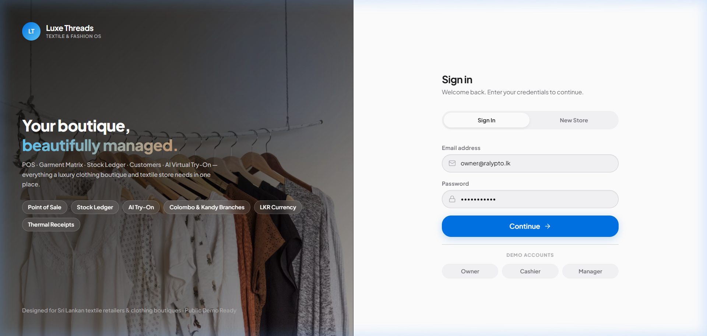
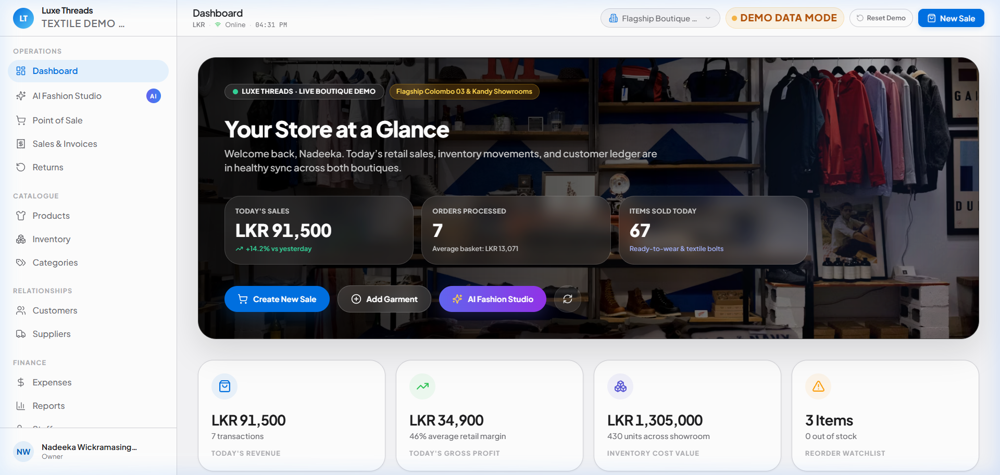
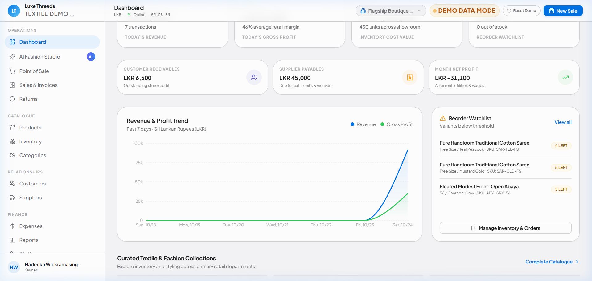
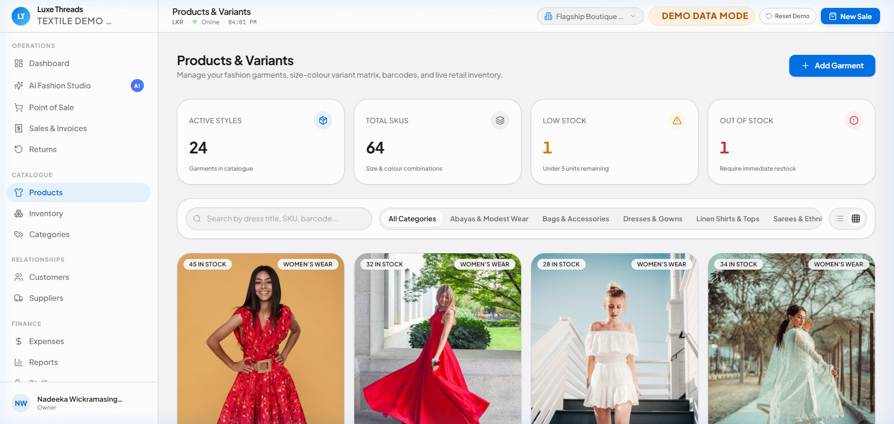
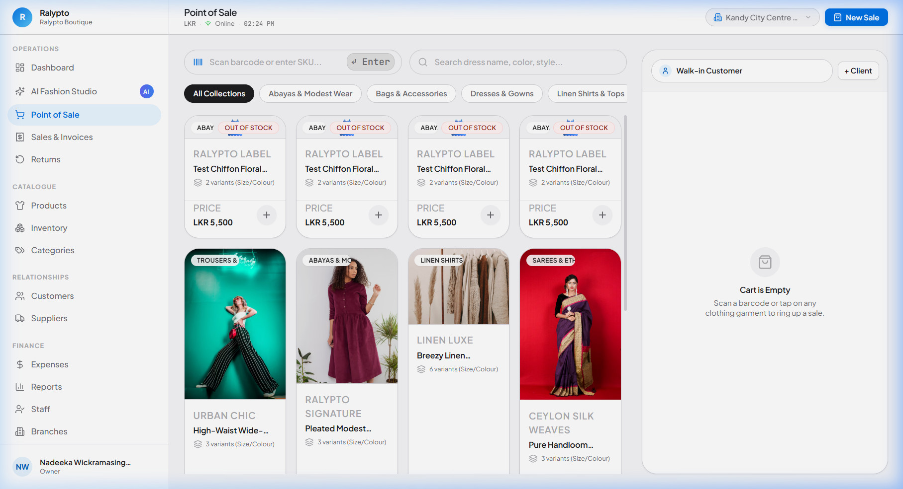
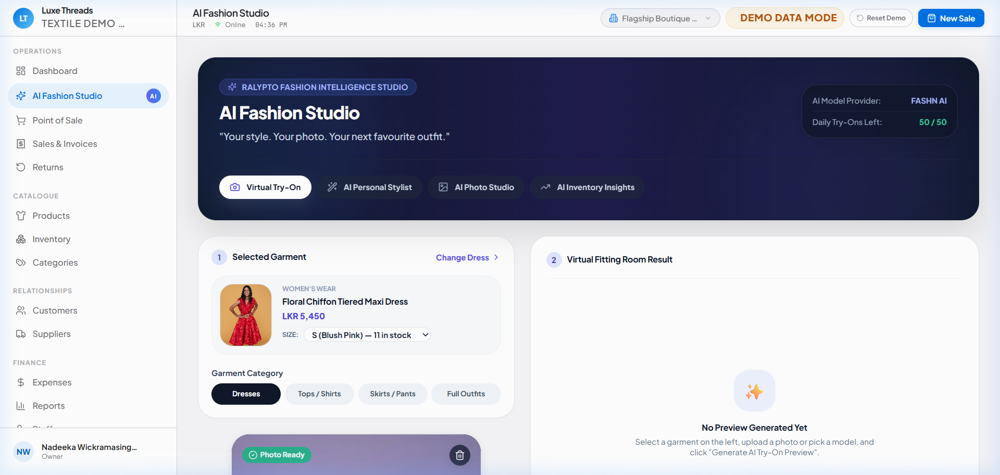
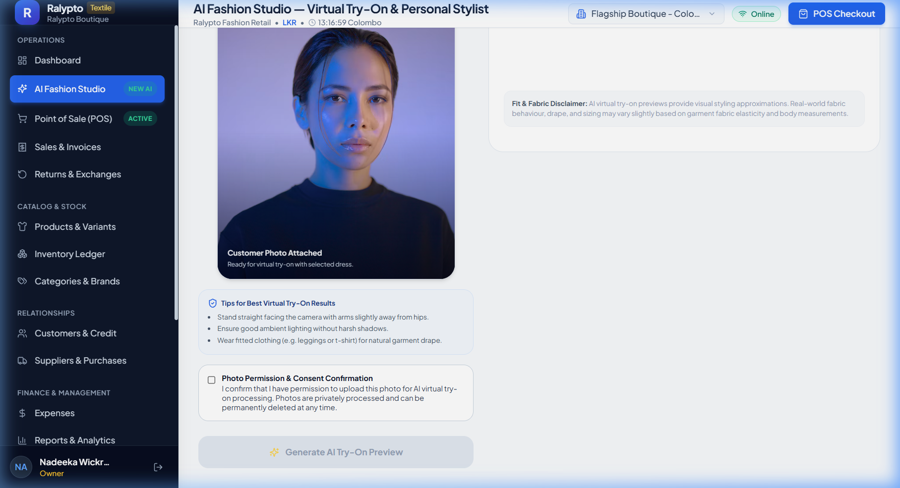
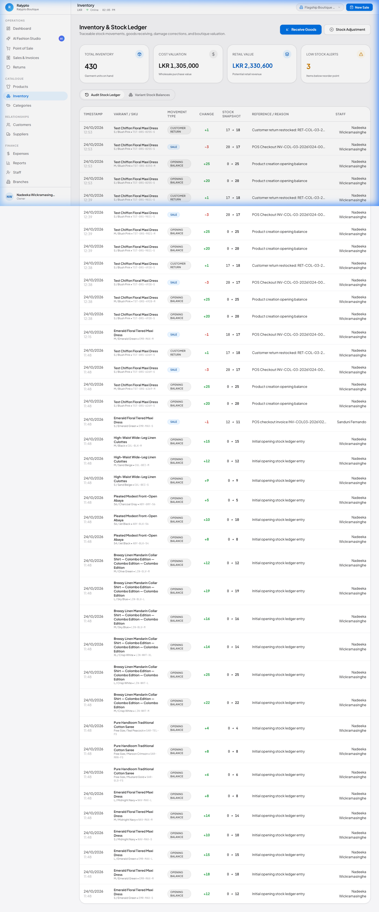
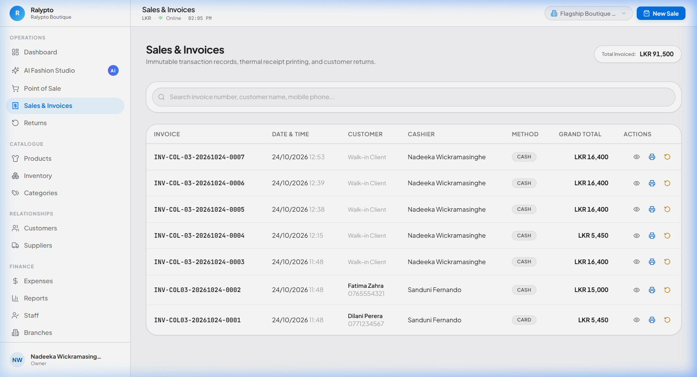

# Luxe Threads — Textile & Dress Shop Management System
### *Luxury Fashion Retail OS · POS · Inventory Matrix · AI Virtual Try-On*

[](https://react.dev/)
[](https://www.typescriptlang.org/)
[](https://vitejs.dev/)
[](https://tailwindcss.com/)
[](https://www.prisma.io/)
[](https://expressjs.com/)
[](LICENSE)

---

## 🌟 Overview

**Luxe Threads** (also known as the **Ralypto Textile Management System**) is an enterprise-grade retail management platform engineered specifically for **clothing boutiques, textile shops, saree emporiums, dress stores, and fashion retail chains**.

Designed with **Apple's minimalist aesthetic philosophy**—prioritizing refined typography, deliberate whitespace, and smooth transitions—combined with the visual elegance of a **high-end luxury fashion brand**. The platform features **cinematic hero banners with dark layered gradient overlays**, high-resolution portrait garment photography, and a **deterministic client-side demo engine** that is 100% client-ready and deployable on public demo URLs.

---

## 📸 Visual Showcase & Tour

### 1. Split-Screen Cinematic Sign In
Experience a refined entry experience featuring high-fashion boutique photography on the left with subtle feature highlights, paired with an Apple-style auth panel on the right featuring **1-click instant demo access** for Store Owner, Manager, and Cashier roles.



---

### 2. Executive Store Dashboard
A cinematic boutique hero section with a dark gradient overlay displays real-time telemetry: today's revenue in Sri Lankan Rupees (LKR), orders processed, and items sold. Beneath it are Apple-style glassmorphic metric cards, gross profit calculations, and instant quick actions.



---

### 3. Analytics, Revenue Trends & Reorder Watchlist
Interactive Recharts area graphs render 7-day revenue versus gross profit trends, accompanied by live reorder alerts that dynamically highlight low-stock and out-of-stock garment variants.



---

### 4. Image-Led Fashion Catalog & Variant Matrix
Showcases dresses, sarees, abayas, kurtis, linen shirts, and accessories in luxury 3:4 portrait aspect ratio cards. Features instant category filter chips, search, barcode indicators, and stock health badges.



---

### 5. High-Speed Point of Sale (POS) & 80mm Thermal Receipt Generator
Designed for fast front-desk checkout. Cashiers can tap catalog cards or scan barcodes, adjust quantities, apply itemized discounts, select tender methods (Cash, Card, Credit, Bank Transfer), and immediately preview/print formatted 80mm thermal receipts with customized boutique return policies.



---

### 6. AI Fashion Studio & Virtual Try-On
The industry-first **AI Virtual Fitting Room** allows boutique customers or sales assistants to upload a shopper's photo, select any real garment from the shop's catalog, and generate an AI-rendered preview showing the customer wearing the outfit. Also includes an **AI Personal Stylist**, **AI Product Photo Studio**, and **AI Inventory Insights**.



#### AI Virtual Fitting Room Result


---

### 7. Multi-Variant Inventory Matrix & Stock Movement Ledger
Tracks garments by SKU, size, color, reorder threshold, and supplier. Features real-time stock deductions upon checkout, low-stock threshold triggers, and full audit logs.



---

### 8. Sales Audit Ledger & Financial Performance
Maintains a detailed invoice ledger with search, cashier tracking, customer receivable balances, credit limit monitoring, and thermal receipt re-prints.



---

## ✨ Key Feature Highlights

- **Apple-Inspired Design System**: Built with a custom Tailwind design system (`#F5F5F7` canvas, `#FFFFFF` cards, `#0071E3` action blue, soft neutral borders `#D2D2D7`, and Apple typography).
- **Cinematic Black Gradient Overlays**: Strategic image-backed banners create visual depth and hierarchy across Dashboard, Sales, Inventory, Reports, and Login screens.
- **Garment Matrix (Size / Color / SKU)**: Tailored specifically for textiles and fashion—manages multiple sizes (XS to 3XL, Saree yards) and colors per design.
- **Client Credit Ledger & Loyalty Points**: Tracks regular customers, outstanding credit balances, credit limits, and circulating loyalty rewards points.
- **Dual Showroom / Multi-Branch Ready**: Preconfigured for flagship operations (Colombo 03 — Galle Road) and branch showrooms (Kandy City Centre).
- **Sri Lankan Retail Localization**: Built with default **LKR (₨)** currency formatting, `Asia/Colombo` (UTC+05:30) timezone, and British/Sri Lankan date formatting (`DD/MM/YYYY`).
- **Deterministic Live Demo Mode**: Includes [`demoStore.ts`](frontend/src/services/demoStore.ts) and [`mockData.ts`](frontend/src/data/mockData.ts). If the backend is offline or the frontend is hosted on static platforms like Vercel or Netlify, the application automatically runs in demo mode with live simulated sales, stock deductions, and a **1-click "Reset Demo Data"** feature.

---

## 🛠️ Architecture & Tech Stack

### Frontend
- **Framework**: [React 18](https://react.dev/) + [Vite 6](https://vitejs.dev/)
- **Language**: [TypeScript](https://www.typescriptlang.org/) (Strict mode, 0 build errors)
- **Styling**: [Tailwind CSS 3.4](https://tailwindcss.com/) with custom tokens, `aspect-3/4` portrait ratios, and custom cubic-bezier animations
- **Icons & Motion**: [Lucide React](https://lucide.dev/) + [Motion](https://motion.dev/)
- **Charts & Telemetry**: [Recharts](https://recharts.org/)
- **State Management**: [Zustand](https://zustand-demo.pmnd.rs/) + LocalStorage persistence

### Backend
- **Runtime**: [Node.js](https://nodejs.org/) (v18+)
- **Framework**: [Express.js](https://expressjs.com/) with TypeScript
- **ORM & Database**: [Prisma ORM](https://www.prisma.io/) with SQLite (local zero-config) / PostgreSQL (production)
- **Authentication**: JWT authentication with role-based access control (RBAC: Owner, Manager, Cashier)
- **AI Integrations**: FASHN AI API & Google Gemini Vision API for virtual try-on and styling intelligence

---

## 🚀 Quick Start Guide

### Prerequisites
- **Node.js**: v18.0.0 or higher
- **npm** or **yarn**

### 1. Clone the Repository
```bash
git clone https://github.com/Arkeshak/Ralypto-Textile-Management-System.git
cd Ralypto-Textile-Management-System
```

### 2. Install Dependencies
You can install both frontend and backend dependencies:

```bash
# Install root, frontend, and backend packages
npm run install:all
```

*Or manually in each folder:*
```bash
# In backend/
cd backend
npm install

# In frontend/
cd ../frontend
npm install
```

### 3. Configure Environment Variables
Copy the sample environment configuration:
```bash
# In backend/
cp .env.example .env
```

*(Optional)* In `backend/.env`, set your AI keys if using live AI features:
```env
FASHN_AI_API_KEY=your_key_here
GEMINI_API_KEY=your_key_here
```

### 4. Initialize Database & Seed
```bash
cd backend
npx prisma db push
npx prisma db seed
```

### 5. Start Development Servers
From the project root:
```bash
npm run dev
```

Or run frontend and backend independently:
```bash
# Backend server (http://localhost:5000)
cd backend && npm run dev

# Frontend dev server (http://localhost:5173)
cd frontend && npm run dev
```

Open your browser at **`http://localhost:5173`**.

---

## 🔑 Pre-Configured Demo Accounts

For evaluation and demonstration purposes, use the 1-click login buttons on the sign-in screen or the following credentials:

| Role | Email | Password | Permissions |
|---|---|---|---|
| **Store Owner** | `owner@luxethreads.lk` | `password123` | Full administrative access, AI Studio, reports, settings |
| **Store Manager** | `manager@luxethreads.lk` | `password123` | Products, inventory, purchases, sales, customers |
| **Front Cashier** | `cashier@luxethreads.lk` | `password123` | High-speed POS billing, returns, receipt generation |

---

## 🚢 Production Build & Deployment

### Build Frontend
```bash
cd frontend
npm run build
```
Generates an optimized, tree-shaken static production bundle in `frontend/dist/`.

### Static Demo Deployment (Vercel / Netlify / GitHub Pages)
The frontend is designed to run statically without requiring a backend server. The transparent fallback layer in `api.ts` connects seamlessly to the built-in browser store (`demoStore.ts`), enabling instant, zero-cost public demonstrations.

---

## 📄 License

This project is licensed under the [MIT License](LICENSE).

---

<p align="center">
  <b>Luxe Threads Retail Operating System</b><br/>
  Crafted for modern clothing boutiques, fashion emporiums, and textile retailers.
</p>
